# Cloudsail skin for Zammad

A Cloudflare Worker on `support.cloudsail.uk/*` that makes Zammad's agent ticket view feel like a chat app, without changing Zammad.

| Stock Zammad 7.2.3 | With the skin |
|---|---|
| 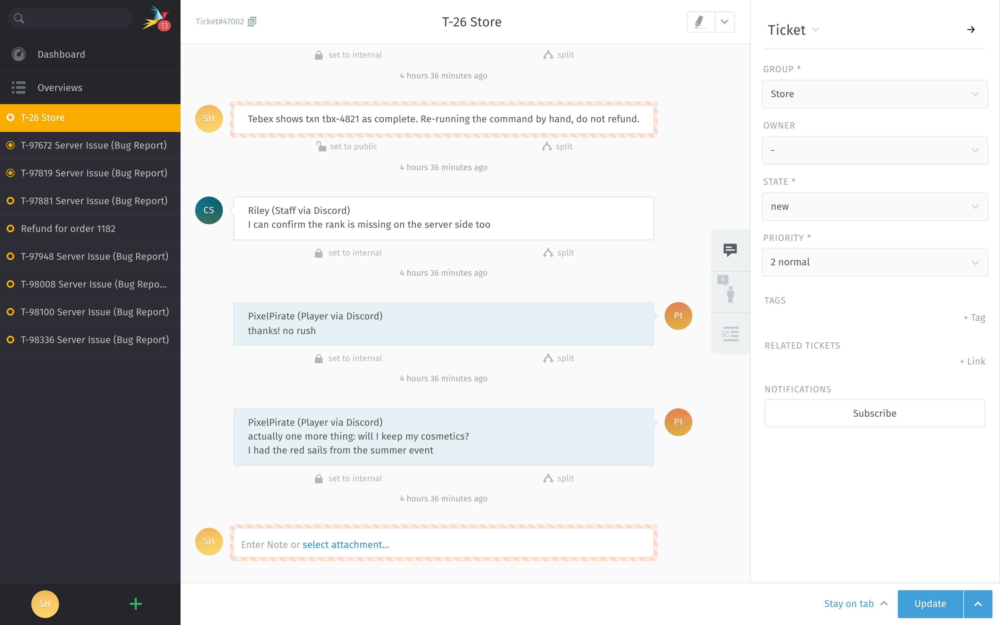 | 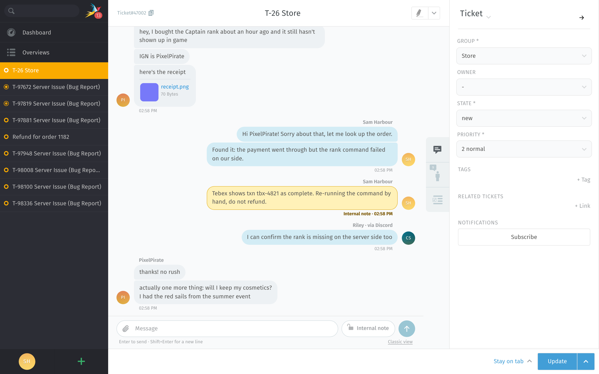 |

Judgment calls and what was checked against the real thing are in [DECISIONS.md](DECISIONS.md).

## What it does

**One Worker, three jobs**

1. Serves `skin.css`, `skin.js`, `login.css` and the login logo from `/__cloudsail/*`. Same origin, so Zammad's CSP (`script-src 'self'`, `style-src 'self'`) allows them as it is.
2. Adds them to the `<head>` of every HTML page: the login styling always, the chat skin unless the kill switch is off.
3. Keeps a Zammad logout local instead of ending the whole Cloudflare Access session.

Jobs 1 (login part) and 3 are the old login Worker, moved over unchanged. `legacy-login-worker.js` stays in the repo as the rollback.

**The ticket view** (legacy desktop UI, the default in 7.2)

- **Bubbles.** Player on the left, agents on the right, grouped by sender, with the sender's name above a group, the time under it and a divider per day. The bot's first line (`PixelPirate (Player via Discord)`) becomes the sender name. Internal notes are yellow and labelled.
- **Less clutter.** The row under every message (set to internal, split, delete, "3 minutes ago") is hidden. Click a bubble and Zammad's own details and actions unfold, as before.
- **Composer pinned at the bottom.** **Enter sends, Shift+Enter is a new line.** The paperclip attaches files; so does pasting (a pasted screenshot becomes a file, not an inline image) and dropping a file anywhere on the conversation.
- **Always a note.** The article-type picker is hidden and every reply is a **public note** on the open ticket. Before anything is sent, the skin checks Zammad's own form fields say `note` with the chosen visibility; if they don't, nothing is sent.
- **Internal note toggle.** A pill next to the composer. On: the composer turns yellow and says "only staff can see this", and so does the bubble. It stays on for that ticket until it's switched off.
- **Scrolls to the newest message**, and stays there while images load or the composer grows. A "jump to newest" button appears when you scroll up. Live updates are Zammad's own and untouched.
- **Sidebar and the Update button** work as before (group, owner, state, priority, tags, macros), slightly tighter. A change in the sidebar is saved with the next message, or with Update.
- **Light and dark** follow Zammad's theme.

It drives Zammad's own reply form rather than replacing it, so drafts, `::` text modules, `@@` mentions, upload limits, validation and time accounting behave as they always did.

### Switches

| Switch | Who | How | Effect |
|---|---|---|---|
| **Kill switch** | everyone | `SKIN_ENABLED = "false"` on the Worker ([below](#kill-switch)) | Skin is no longer injected. Tabs that are already open drop it within 5 minutes, or at once when the tab gets focus. Login styling and logout rewrite keep working. |
| **Classic view** | one browser | "Classic view" under the composer, or open `https://support.cloudsail.uk/?cloudsail-skin=off` | Stored in `localStorage` (`cloudsail.skin = off`). "Chat view" under the composer, or `?cloudsail-skin=on`, turns it back on. |
| **Classic composer** | one ticket | "Classic composer" under the composer (offered on tickets that didn't come from Discord) | That ticket gets Zammad's own form, type picker included, until the page is reloaded. Bubbles stay. |

`window.CloudsailSkin.disable()` / `.enable()` in the browser console do the same as the per-browser switch.

### Fail safe

- All of `skin.css` hangs off classes that `skin.js` adds after checking the page. No script, no classes, no effect.
- Each ticket is checked for the elements the skin relies on. If the reply form isn't as expected (read-only ticket, a Zammad update that moved things), the composer stays Zammad's; the bubbles only need the article list.
- Five errors in a session switch the skin off until the next reload.
- The Worker calls `passThroughOnException()`: if it throws, Cloudflare serves the request from Zammad directly.
- Zammad's new `/desktop` and `/mobile` apps are left alone.

## Layout

```
wrangler.toml            the Worker: name, route, SKIN_ENABLED
wrangler.legacy.toml     rollback: deploys legacy-login-worker.js to the same Worker
legacy-login-worker.js   the old login-only Worker, unchanged
src/worker.js            asset routes, HTML injection, logout rewrite, kill switch
src/assets/skin.css      the look (colour tokens at the top)
src/assets/skin.js       grouping, composer, toggle, scrolling, switches
src/assets/login.css     login page styling (from the old Worker)
src/assets/cf-logo.svg   logo on the Cloudflare Access login button (from the old Worker)
test/                    seed.mjs, e2e.mjs (Playwright), worker.test.mjs
screenshots/             written by test/e2e.mjs
```

**Colours.** The palette is a block of `--cs-*` variables at the top of `src/assets/skin.css` (light and dark). See DECISIONS.md S15 before treating them as final.

## Deploy

Needs Node 20+ and a Cloudflare API token (or `wrangler login`) that can edit Workers and routes on the `cloudsail.uk` zone.

```sh
cd zammad-skin
npm ci
npm test                 # Worker tests, local, no Cloudflare account needed
npx wrangler deploy
```

**First deploy: move the route.** Only one Worker can own `support.cloudsail.uk/*`, and today that's the old login Worker.

1. Cloudflare dashboard → Workers & Pages → the old login Worker → Settings → Domains & Routes → delete the `support.cloudsail.uk/*` route. Keep the Worker itself: it's a second way back.
2. `npx wrangler deploy`. It creates the Worker `cloudsail-support-skin` and attaches the route (`wrangler.toml`).

Between the two steps Zammad is served without any Worker for a few seconds: the login page is unstyled and a logout goes to Access. Nothing else changes.

If you'd rather keep one Worker, set `name` in `wrangler.toml` and `wrangler.legacy.toml` to the old Worker's name and skip step 1: the deploy replaces its code, and the rollbacks below still apply.

**Check it:**

```sh
curl -sI https://support.cloudsail.uk/__cloudsail/skin.js | head -1     # 200 (Access may answer 302 first)
```

Then open a ticket. In the browser's dev tools the page response carries `x-cloudsail-skin: on; v=<hash>`.

**Later deploys** are just `npx wrangler deploy`. The skin's URLs carry a content hash, so agents get the new version on their next page load.

### Kill switch

Turns the chat skin off for everyone. Login styling and logout rewrite stay.

```sh
npx wrangler deploy --var SKIN_ENABLED:false     # off
npx wrangler deploy                              # on again (wrangler.toml says "true")
```

Without a terminal: dashboard → Workers & Pages → `cloudsail-support-skin` → Settings → Variables and Secrets → set `SKIN_ENABLED` to `false` → Deploy. The next `wrangler deploy` puts back whatever `wrangler.toml` says, so change it there too if it should stay off.

Open tabs notice within 5 minutes (or when the tab is next focused) and drop the skin without a reload.

### Roll back to the old Worker

Fastest first:

1. **Previous version of this Worker:** `npx wrangler rollback` (or dashboard → the Worker → Deployments → Rollback). Undoes the last deploy.
2. **The old login-only code, same Worker and route:**
   ```sh
   npx wrangler deploy --config wrangler.legacy.toml
   ```
   This deploys `legacy-login-worker.js` as `cloudsail-support-skin`. Exactly the old behaviour, no skin code at all. `npx wrangler deploy` brings the skin back.
3. **The old Worker itself** (if it was kept): dashboard → `cloudsail-support-skin` → Settings → Domains & Routes → delete the route, then add `support.cloudsail.uk/*` to the old Worker.

After 2 or 3, tabs that still have the skin loaded drop it on their next status check (the status address answers 404 once the skin Worker is gone), and everyone else on their next page load.

## One Zammad setting to leave off

**"Article - visibility confirmation dialog"** in Zammad's ticket settings (`ui_ticket_zoom_article_visibility_confirmation_dialog`, off by default). With it on, Zammad asks for confirmation every time a note is made public, and the skin's default is public. The skin then leaves the composer classic (bubbles still apply) rather than bypass the setting.

The other default that matters, "Note - default visibility: internal", needs no change: the skin sets every new reply to public itself.

## Testing

Everything was run against **Zammad 7.2.3** in Docker (`zammad/zammad-docker-compose:7.2.3-0000`, the Docker Hub copy of the image the compose project uses), through this Worker running locally in workerd (`wrangler dev`), with Playwright driving Chromium.

```sh
# 1. A throwaway Zammad on http://localhost:8080 (github.com/zammad/zammad-docker-compose, VERSION=7.2.3-0000)
# 2. Seed it: admin, agent, bot user, a Discord-style customer and tickets
node test/seed.mjs
# 3. The Worker, in front of it, on http://127.0.0.1:8787
npm run dev
# 4. The browser test; writes screenshots/ and screenshots/e2e-results.txt
npm install --no-save playwright && npx playwright install chromium    # if Playwright isn't installed
node test/e2e.mjs
```

`test/seed.mjs` creates users and tickets: never point it at the real instance.

`npm test` runs `test/worker.test.mjs`: the Worker against a stub origin (asset routes, injection, kill switch, logout rewrite, pass-through).

Last run: 58/58 browser checks ([screenshots/e2e-results.txt](screenshots/e2e-results.txt)), 8/8 Worker tests.

| | |
|---|---|
| Enter sent a public note | 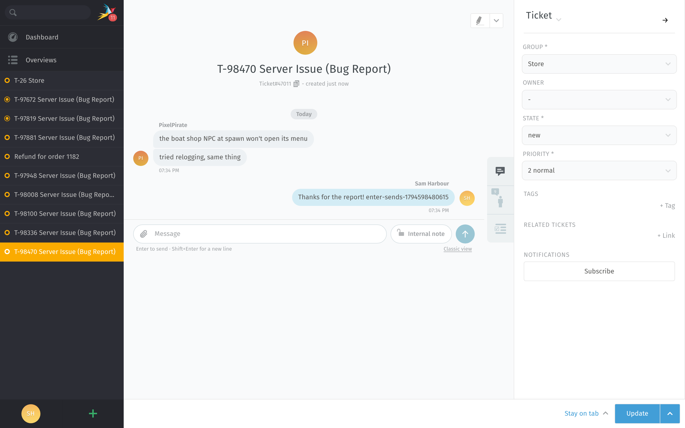 |
| Shift+Enter added a line | 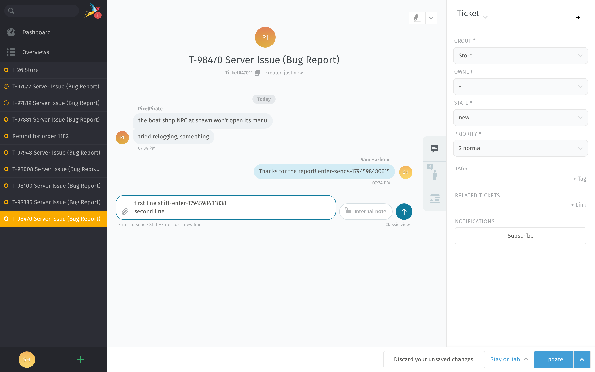 |
| Internal toggle on | 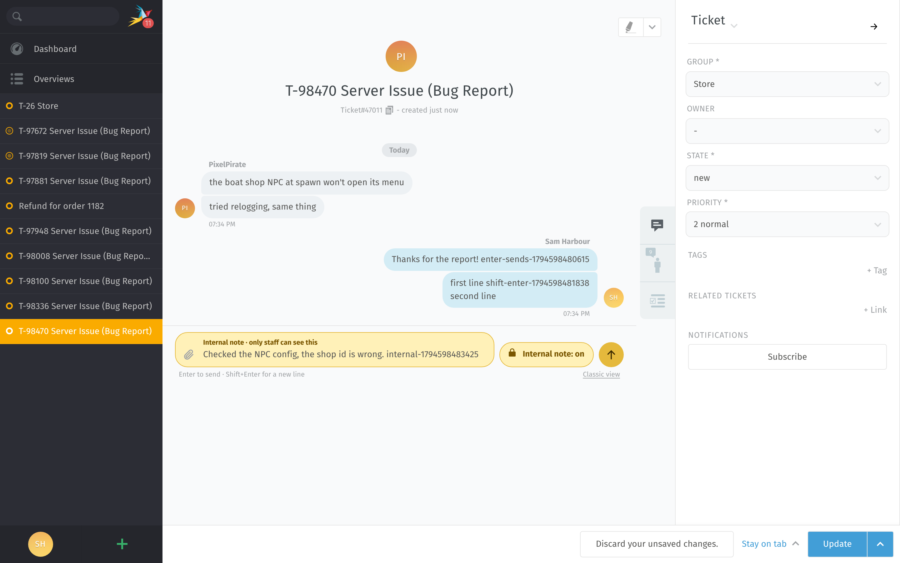 |
| Internal note sent | 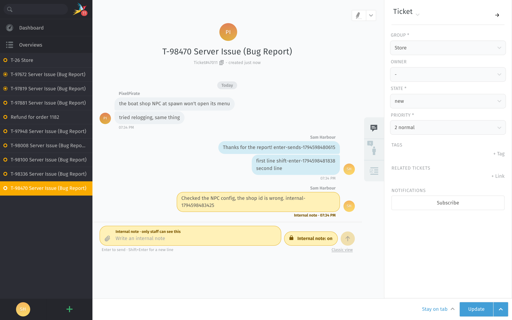 |
| Click a bubble for Zammad's details | 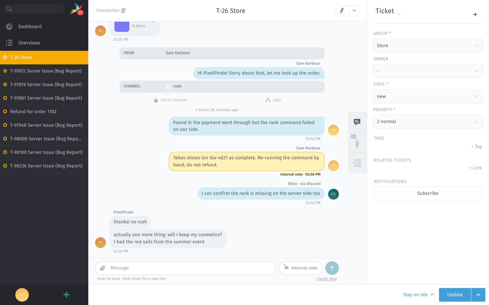 |
| Button, paste and drop attachments | 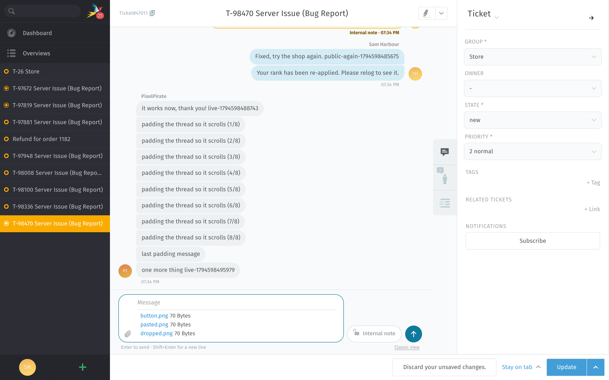 |
| A ticket that isn't from Discord | 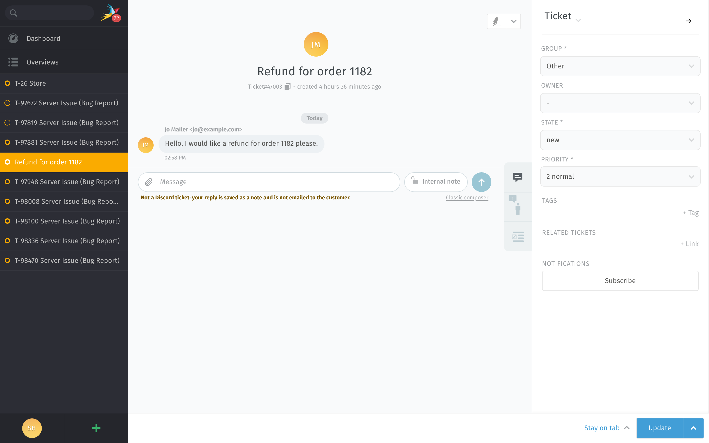 |
| Classic composer for one ticket | 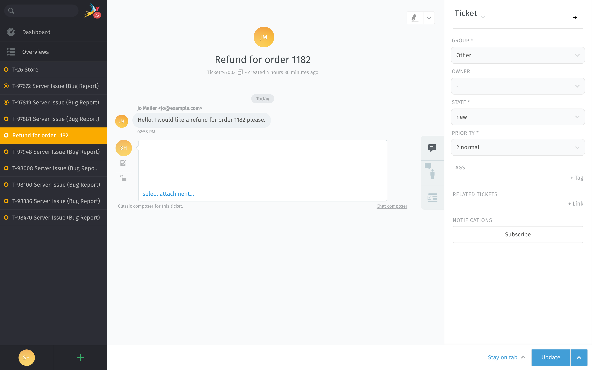 |
| Skin off for this browser | 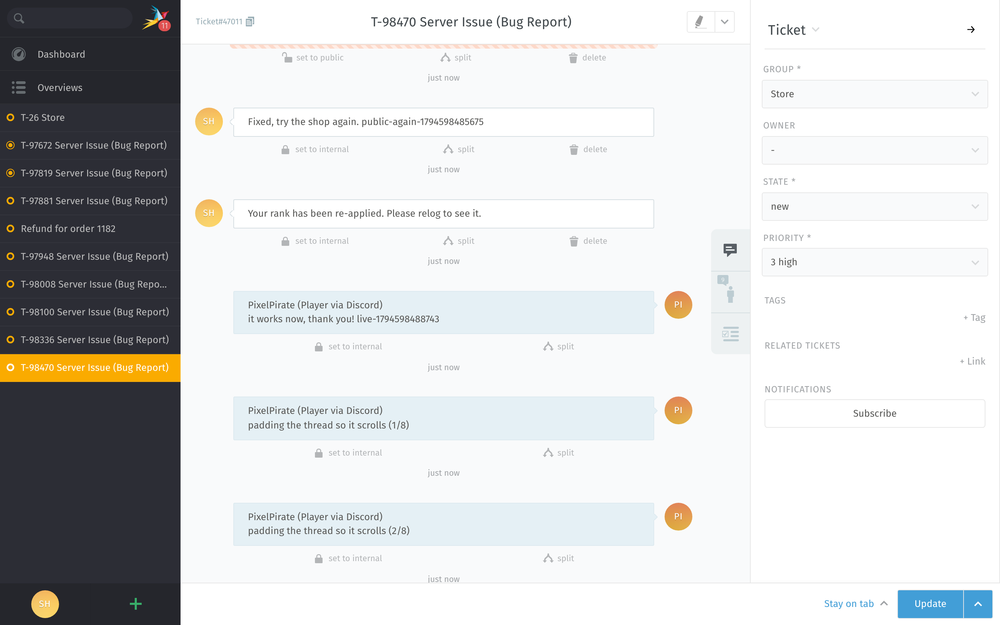 |
| Dark theme | 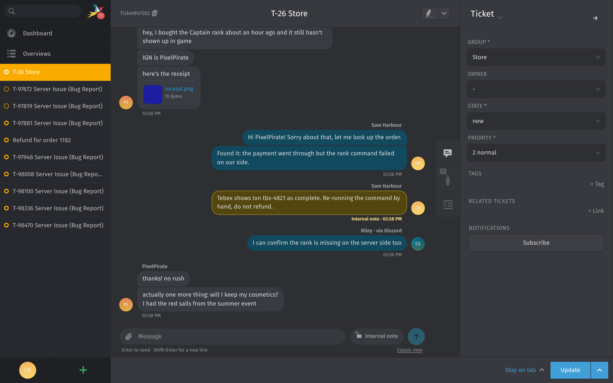 |
